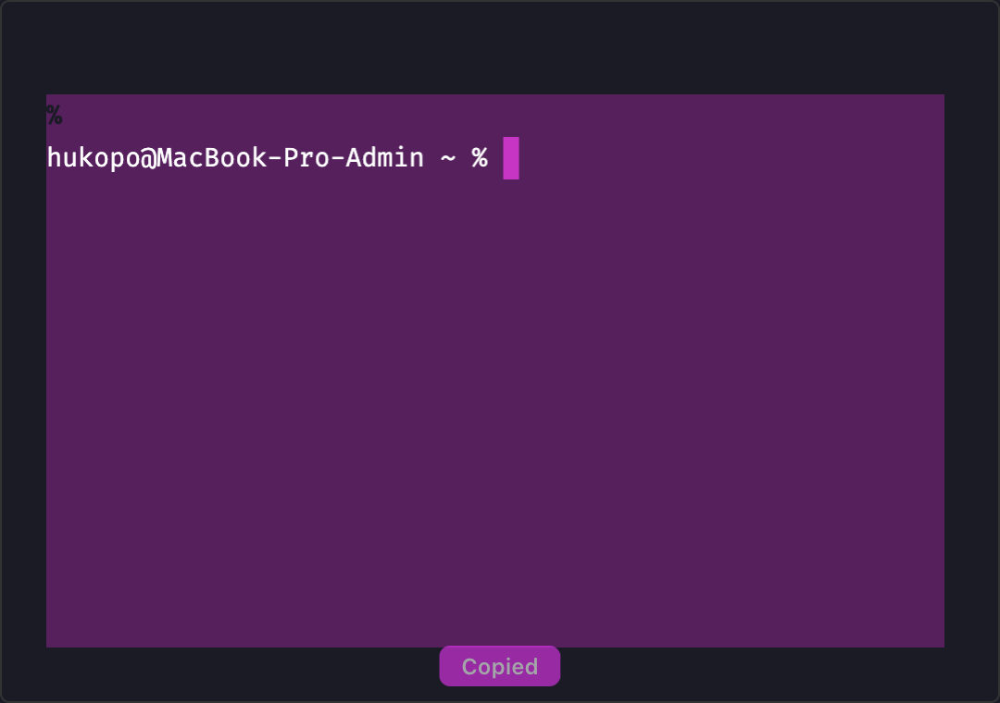

# hyper-copy-toast

A [Hyper](https://hyper.is) plugin that **copies text as soon as you select it** and flashes a fuchsia **“Copied”** toast at the bottom of the terminal — just like Claude Code.



## Install

```sh
git clone https://github.com/hukopo/hyper-copy-toast ~/.hyper_plugins/local/hyper-copy-toast
cd ~/.hyper_plugins/local/hyper-copy-toast && npm i && npm run build
```

Add it to `~/.hyper.js`:

```js
localPlugins: ['hyper-copy-toast'],
```

Then **fully restart Hyper (Cmd+Q)** — a new window or View → Reload won't pick up new plugins.

> No need to enable the built-in `copyOnSelect` option.

## Development

```sh
npm run build   # src/index.ts → dist/index.js
```

`src/index.ts` wraps Hyper's `Term` component, subscribes to xterm's `onSelectionChange`, writes the selection to the clipboard via `electron.clipboard` and blinks the toast for 600 ms.

Tested on Hyper 3.4.1, macOS.

## License

MIT

---

## 🇷🇺 Кратко

Плагин для Hyper: **копирует текст сразу при выделении** и на мгновение мигает фуксиевой плашкой **«Copied»**.

Установка: склонировать в `~/.hyper_plugins/local/hyper-copy-toast`, выполнить `npm i && npm run build`, добавить `'hyper-copy-toast'` в `localPlugins` в `~/.hyper.js` и **полностью перезапустить Hyper (Cmd+Q)**.
